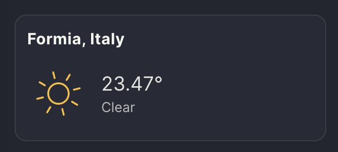

<!--
SPDX-FileCopyrightText: 2025 Bonfire Networks <https://bonfirenetworks.org/contact/>

SPDX-License-Identifier: AGPL-3.0-only
SPDX-License-Identifier: CC0-1.0
-->

# Add a new widget

Widgets are reusable components that encapsulate data and provide context-specific information to users based on the pages they are currently visiting. They are typically placed in the right sidebar ( refers to the [Design Guidelines](../topics/DESIGN.md) section to learn more about Bonfire user experience), and developers can define which widgets should appear on each page and in what order. 

Developers can include options for users to enable, disable, or rearrange the order of widgets when possible.

A widget usually consists of a title and data formatted in various ways, such as links, data visualizations, actions, or information fetched from third-party apps. In this section, we will create a new widget that utilizes the user's location (if provided) and the [bonfire_geolocate](https://github.com/bonfire-networks/bonfire_geolocate) library to obtain the correct coordinates. These coordinates will then be used to retrieve the location's weather information using an external library. Additionally, we will create a setting that allows users to optionally include the widget on their profile.

This example is simple yet meaningful because it touches upon different parts of the Bonfire framework during the tutorial. The code for this widget is available [here](https://github.com/bonfire-networks/bonfire_geolocate/tree/main/lib/web/components/widgets).



## Let's code!

The first step is to identify the most appropriate extension for this widget. In this case, we can include the widget in the `bonfire_geolocate` extension, which already handles all the necessary logic for dealing with geolocations.

Widgets are typically included in `lib/web/components/widgets`. Bonfire uses Surface on the frontend, so we'll create two files:

- `widget_forecast_live.ex`
- `widget_forecast_live.sface`

This forecast widget is a stateless component, meaning it won't handle any internal state. Therefore, the `widget_forecast_live.ex` code will be quite basic:

```elixir
defmodule Bonfire.Geolocate.WidgetForecastLive do
  use Bonfire.UI.Common.Web, :stateless_component

  prop location, :string, default: nil
end

```

We use `:stateless_component`, a [function](https://github.com/bonfire-networks/bonfire_ui_common/blob/main/lib/web.ex#L543) that wraps the `Surface.Component` and includes a list of [helpers](https://github.com/bonfire-networks/bonfire_ui_common/blob/main/lib/web.ex#L575) widely used across most components.

Since we want to include the widget on the user profile, we can gather the location data from there, so we define the `location` prop.

Widgets are wrapped in a [WidgetBlockLive](https://github.com/bonfire-networks/bonfire_ui_common/blob/main/lib/components/widgets/widget_block_live.ex) component that takes care of injecting a style and the basic prop as the title. The initial implementation of our `widget_forecast_live.sface` looks like this:

```elixir
<Bonfire.UI.Common.WidgetBlockLive widget_title={e(@location, "")}>
  hello world
</Bonfire.UI.Common.WidgetBlockLive>

```

### Declare the widget

Declare the widget so the dashboard and the guest homepage can offer it, and admins and users can turn it on in their widget settings:

```elixir
defmodule Bonfire.Geolocate.WidgetForecastLive do
  use Bonfire.UI.Common.Web, :stateless_component

  declare_widget(l("Weather"), id: :forecast, current_user_required: true)

  prop location, :string, default: nil
end
```

`declare_widget/2` takes these options, all optional:

- `id`: the atom that settings and flavour config refer to the widget by. By default it comes from the module name: `WidgetForecastLive` gives `:forecast`.
- `width`: where the widget can go. `:wide` fits a main area only, eg. a carousel. `:narrow` fits a sidebar only, eg. a compact list. By default a widget fits either, so leave `width` out unless it only works in one. A widget that fits either sits in exactly one area of a page, which a person can change in their settings.
- `current_user_required`: `true` when the widget only makes sense for someone signed in. It's then never offered on the guest homepage, or to guests anywhere.
- `embeddable`: whether it can be embedded on other sites. By default, a widget is embeddable when guests can see it.
- `props`: the props it gets wherever it's placed, eg. `[limit: 5]`.
- `icon` and `description`: shown in the widget settings.

All declared widgets, plus the ones admins write themselves, are listed by `Bonfire.UI.Common.Widgets.registry/0`.

A widget should render inside `WidgetBlockLive`, and wrap plain content (text, a button) in an element with `data-role="widget-body"`, so it takes the same gutter as its title wherever it's placed. A widget that renders nothing is hidden, with no empty gap left behind. When the same widget should look different in a main area and a sidebar (eg. cards on the homepage, a compact list in a sidebar), use its `showing_within` prop, which is `:main` or `:sidebar`.

## Widgets in places

A place is a part of a page that shows a list of widgets: the dashboard's main area (`{Bonfire.Web.Views.DashboardLive, :main}`) and sidebar (`{Bonfire.Web.Views.DashboardLive, :sidebar}`), and the guest homepage (`{Bonfire.Web.Views.HomeLive, :main}`). A page renders its place with `Bonfire.UI.Common.Widgets.for_place(place, current_user)`, and its settings with `Bonfire.UI.Common.PlaceWidgetsSettingsLive`.

What a place shows is decided in layers, each overriding the one before:

1. The flavour's config gives the default list, in order.
2. Admins change it for their instance in instance settings, Widgets: the "Dashboard (members)" and "Homepage (visitors)" tabs.
3. Each person changes their own dashboard in their dashboard settings.

### In a flavour

A flavour sets each place's default widgets in its config, by id:

```elixir
config :bonfire, Bonfire.Web.Views.DashboardLive,
  widgets: [
    main: [:welcome, :instance_pinned, :trending_discussions, :polls_closing_soon],
    sidebar: [:community_links, :community_rules, :mods]
  ]

config :bonfire, Bonfire.Web.Views.HomeLive,
  widgets: [main: [:intro, :mods, :community_links, :instance_pinned, :groups]]
```

`ember.exs` is every flavour's base config, and the flavour's own config is loaded after it. A list in the flavour's config replaces ember's list; it isn't merged with it. So to add one widget to ember's list, repeat the whole list with it added.

- **Choose and order:** list the widget ids you want, in the order you want them.
- **Areas:** the keys you list (`main`, `sidebar`) are the page's areas, and a widget sits in one of them. A widget goes where you list it, or if you don't list it, in the first area its `width` allows. A page with no `sidebar` key has no sidebar widgets.
- **Change a widget's props:** list it as `{id, props}`, eg. `{:trending_discussions, [limit: 3]}`. These are merged over the props it was declared with.
- **Leave a widget out:** don't list it. It's still offered in the settings, switched off, so an admin or a person can turn it on.
- **Disable a widget completely:** disable its module, or its whole extension, with the usual modularity config, eg. `config :bonfire_geolocate, Bonfire.Geolocate.WidgetForecastLive, modularity: :disabled`. It's then never offered in any place or setting.
- **Add a widget:** declare it in its extension (see above), then list its id.

A widget can also be on by default for some places or people beyond its flavour's list, by defining `included_by_default?(place, current_user)`. For example, the feed widget (`Bonfire.UI.Social.WidgetFeedLive`) is on in the dashboard for people who chose the old feed-only dashboard.

Flavours set their own lists rather than overriding the `DashboardLive` or `HomeLive` templates. The pages' templates are ember's, and a flavour only overrides a template for what config can't express.

### What's not a place yet

The page sidebars (profiles, feeds, events, threads...) are still set in code, with the `sidebar_widgets` assign shown below. They will become places too.

On every page with a right sidebar, a flavour can also show the feedback widget with `config :bonfire_ui_common, Bonfire.UI.Common.LayoutLive, widgets: [layout: [:wishes]]`, and an admin can hide it with `[Bonfire.UI.Common.LayoutLive, :include, :wishes]`. Only `:wishes` works there for now.

### Showing a widget in a page's sidebar

To see our widget, we need to include it in a page. Widgets are included in our right sidebar and are defined within a prop called `sidebar_widgets`, which is a list that includes guest and user lists (respectively, the widgets to show when the user is visiting a page while not logged in or when the user is logged in).

We'll include our widget in the logged list, specifying it is in the secondary widget section. The final look of our `sidebar_widget` prop looks like this:

```elixir
sidebar_widgets = [
  users: [
    secondary: [
      Bonfire.Geolocate.WidgetForecastLive, [location: "Naples, Italy"]
    ]
  ]
]

```

We'll include our widget in the user profile page, located in the [Bonfire.UI.Me](https://github.com/bonfire-networks/bonfire_ui_me) extension, a library that deals with all the views related to user profiles and settings.

The `Bonfire.UI.Me.ProfileLive` [mount function](https://github.com/bonfire-networks/bonfire_ui_me/blob/main/lib/views/profile/profile_live.ex#L34) looks like:

```elixir
  def mount(_params, _session, socket) do
    {:ok,
     socket
     |> assign(LiveHandler.default_assigns(is_nil(current_user_id(socket))))}
  end

```

The `default_assigns` function includes data needed for dealing with multiple kinds of interactions and permissions. It also fetches the user from the database and ensures all the data is loaded correctly. The location data is fetched in [profiles_live_handler.ex:95](https://github.com/bonfire-networks/bonfire_ui_me/blob/main/lib/live_handlers/profiles_live_handler.ex#L95), and the widget is included in [profiles_live_handler.ex:274](https://github.com/bonfire-networks/bonfire_ui_me/blob/main/lib/live_handlers/profiles_live_handler.ex#L274).

## Adding Settings

To ensure the user can decide whether they want to include the widget when visiting any user page, we're creating a new setting that optionally shows the widget based on user input.

In `profiles_live_handler.ex:274`, the widget is preceded by `weather_widget_enabled`, a boolean that controls whether the widget should be displayed or not. It makes use of the `Settings.get` function. You can learn more about defining and returning settings in our [Add an Extension Settings](/building/add-an-extension-settings.md) section.

We're adding the settings in the [edit_profile_info_live.sface](https://github.com/bonfire-networks/bonfire_ui_me/blob/main/lib/components/settings/profile/edit_profile_info_live.sface#L99) component (we may later refactor this to add the setting in the defined extension, but this is still a work in progress):

```elixir
<form data-scope="set-weather" phx-change="Bonfire.Common.Settings:set">
    <Bonfire.UI.Common.SettingsToggleLive
      name="Weather"
      description={l("Show the Weather widget on user profile")}
      keys={[Bonfire.Geolocate, :weather]}
      scope={:user}
    />
  </form>

```

At this point, we should be able to see our basic weather widget on our profile page and decide to switch it on and off.

What remains is to include the logic for returning and displaying the weather. We will use the Forecastr library, which is already used in our application and added in the [bonfire](https://github.com/bonfire-networks/bonfire) extension.

The Forecastr library makes use of the Pirate Weather service, so we need a Pirate Weather API KEY. You can generate one on [pirateweather.net](http://pirateweather.net/) and add it at the bottom of your `.env` file:

```elixir
PIRATE_WEATHER_API_KEY=***********************

```

The final component code looks like:

```elixir
{#if e(@location, nil)}
  <Bonfire.UI.Common.WidgetBlockLive widget_title={e(@location, "")}>
    {#case Forecastr.forecast(:today, e(@location, nil),
        units: :metric,
        renderer: Forecastr.Renderer.JSON
      )}
      {#match {:ok,
           %{
             "description" => weather,
             "id" => weather_id,
             "temp" => temp,
             "name" => weather_location
           }}}
        <div
          class="flex items-center gap-3"
          title={l("%{weather} in %{location}", weather: weather, location: weather_location)}
        >
          <Iconify.iconify icon={"meteocons:#{weather_id}"} class="w-16 h-16" />
          <div class="flex flex-col">
            <span class="text-xl text-base-content/90">{temp}°</span>
            <span class="text-sm text-base-content/70">{weather}</span>
          </div>
        </div>
      {#match _}
    {/case}
  </Bonfire.UI.Common.WidgetBlockLive>
{/if}

```

## Next Steps
Although this weather widget is relatively basic, it significantly enhances the user experience by providing relevant metadata fetched from external services. This example demonstrates the potential for integrating additional information and functionality into widgets to create a more engaging and informative user interface.
To further improve this widget, developers can consider including more data points, such as:

- Current moon position and phase
- Daily amount of daylight hours
- Sunrise and sunset times
- Extended weather forecasts
- Weather alerts and notifications

By incorporating these additional features, the widget can provide users with a more comprehensive overview of their location's weather and astronomical information, making it a valuable addition to their profile page.